# JSMCTS Benchmark

JSMCTS is a javascript implementation of <a href="https://en.wikipedia.org/wiki/Monte_Carlo_tree_search">Monte Carlo Tree Search (MCTS)</a> that can be used to implement game playing AIs.

No knowledge of a game's strategy is needed to create a JSMCTS player and JSMCTS does no prior learning or analysis, it starts from scratch evaluating each game state for which it is asked to pick a move.

In an effort to gain some insight into the level of play JSMCTS is achieving it was tested on four games for which optimal/perfect playing strategies are known, two games of perfect information:
* Tic-tac-toe
* Connect Four

one card game:
* Blackjack

and one dice game:
* Pig

All tests were run with default UCT parameters.

For the nondeterministic games an initial study was run to see if determinization improved performance and, if so, how many trials to run per PRNG seed.

## Tic-tac-toe

[Tic-tac-toe](https://en.wikipedia.org/wiki/Tic-tac-toe) is a simple two-player game that always ends in a draw when played perfectly.
The rules we learn as children, from the simplest strategies up to mastering perfect play, were documented in 1993 by Crowley and Siegler[[1]](#references "Crowley, K. and Siegler, R.S., Flexible Strategy Use in Young Children's Tic-Tac-Toe. Cognitive Science, 17: 531-561, 1993.").

### JSMCTS Implementation

[See js/tictactoe.js for full details]

The JSMCTS implementation pits two players against each other, placing Xs and Os on a 3x3 grid.

A heuristic player was implemented for perfect play using the rules from Crowley and Siegler.

#### Heuristic Player Performance

The simulation was first validated by running the heuristic perfect player against itself and verifying that all games ended in a draw:

|Player|Games|Mean Draw Pct vs Perfect Play|Standard Error|Expected|
|---|---|---|---|---|
|Perfect|10000|100.00|0.00|100|

#### MCTS Player Performance

The MCTS player was then tested to see how it performed relative to the heuristic perfect player in forcing a draw as the second player.

The MCTS player achieved perfect play at around 1000 trials (short of exhaustively searching the entire tree of roughly 8! = 40,000 games as second player):

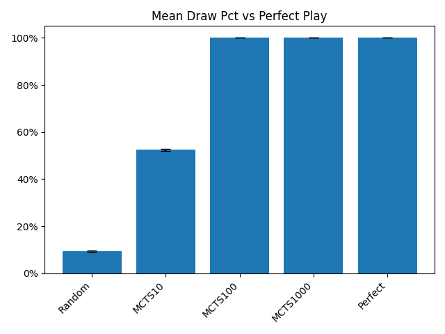

|Player|Games|Mean Draw Pct vs Perfect Play|Standard Error|
|---|---|---|---|
|Random|10000|9.50|0.29|
|MCTS10|10000|52.48|0.50|
|MCTS100|10000|99.96|0.02|
|MCTS1000|10000|100.00|0.00|
|Perfect||100||

## Connect Four

[Connect Four](https://en.wikipedia.org/wiki/Connect_Four) is a two-player game where players drop pieces into columns in a vertical 7x6 grid, attempting to connect four of their own pieces horizontally, vertically, or diagonally.

Connect Four was independently solved by James Dow Allen[[2]](#references "Allen, J.D.: The Complete Book of Connect 4: History, Strategy, Puzzles. Puzzle Wright Press (2010)") and Victor Allis[[3]](#references "Allis, L.V.: A knowledge-based approach of connect-four. J. Int. Comput. Games Assoc. 11(4), 165 (1988)") in 1988, both using knowledge-based approaches, proving that the first player can force a win with perfect play.
John Tromp and others have gone on to solve Connect Four with brute force, proving that the first player can force a win in 41 moves with perfect play.

### JSMCTS Implementation

[See js/connectfour.js for full details]

The JSMCTS implementation pits two players against each other, dropping Xs and Os into a vertical 7x6 grid.

A heuristic player was implemented for perfect play using [Chris Steininger's brute force solver](https://github.com/ChristopheSteininger/c4).

#### Heuristic Player Performance

The simulation was first validated by running the heuristic perfect player against itself and verifying that all games end in a first player win in 41 moves:

|Player|Games|Mean Win Pct vs Perfect Second Player|Standard Error|Expected|
|---|---|---|---|---|
|Perfect|1000|100.00|0.00|100|

|Player|Games|Mean Moves to Win vs Perfect Second Player|Standard Error|Expected|
|---|---|---|---|---|
|Perfect|1000|41.0000|0.00|41|

#### MCTS Player Performance

The MCTS player was then tested to see how it performed relative to the heuristic perfect player.

Tests were run for trials in powers of 10 up to 1,000,000 (the largest value for which it was practical to collect data, taking about 30 seconds per move).

At 1,000,000 trials the MCTS player is finally able to win against a perfect second player, but only around 3 percent of the time:

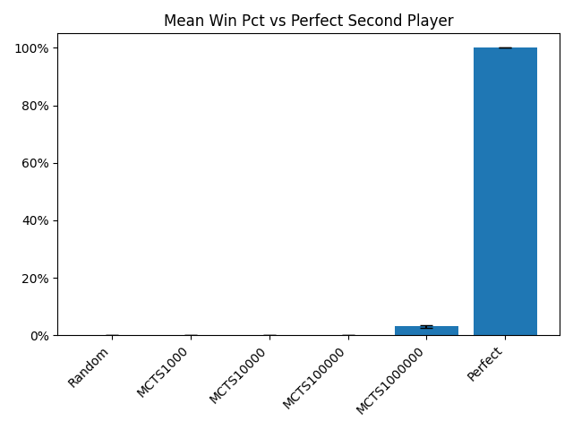

|Player|Games|Mean Win Pct vs Perfect Second Player|Standard Error|
|---|---|---|---|
|Random|1000|0.00|0.00|
|MCTS1000|1000|0.00|0.00|
|MCTS10000|1000|0.00|0.00|
|MCTS100000|1000|0.00|0.00|
|MCTS1000000|1000|3.10|0.55|
|Perfect||100||

Against a perfect first player, which is always able to force a win in at most 41 moves, the MCTS was only able to last around 33 moves at 1,000,000 trials:

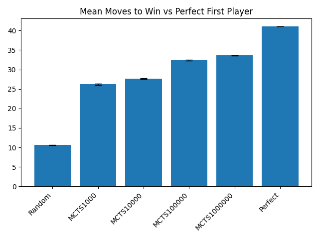

|Player|Games|Mean Moves to Perfect First Player Win vs Player|Standard Error|
|---|---|---|---|
|Random|1000|10.5900|0.1130|
|MCTS1000|1000|26.2240|0.1930|
|MCTS10000|1000|27.6680|0.1506|
|MCTS100000|1000|32.3300|0.1005|
|MCTS1000000|1000|33.6160|0.0581|
|Perfect||41||

Finally, the moves made by the MCTS players in these games can be compared to the moves that the heuristic perfect player would have made, giving a measure of how close they are to perfect play:

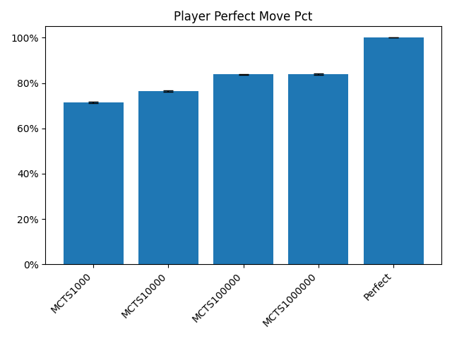

|Player|Move|Mean Perfect Move Pct|Standard Error|
|---|---|---|---|
|MCTS1000|20000|71.58|0.32|
|MCTS10000|20000|76.47|0.30|
|MCTS100000|20000|83.81|0.26|
|MCTS1000000|20000|83.91|0.26|
|Perfect||100||

##### Evaluation Functions

It is known that MCTS performance can be increased with evaluation functions that help rate the relative player advantage of board positions using fewer random trials, though such functions may require expert game knowledge (or machine learning) to construct.

Here we look at a very simple evalutation function that doesn't require much more than an understanding of the rules: players are given points for each four-in-a-row line still available to them (not blocked by their opponent), with the point value of each line exponentially increasing for every step that has been made towards completing it.

Even this simple evaluation funcion increased the win rate at 1,000,000 trials almost tenfold:

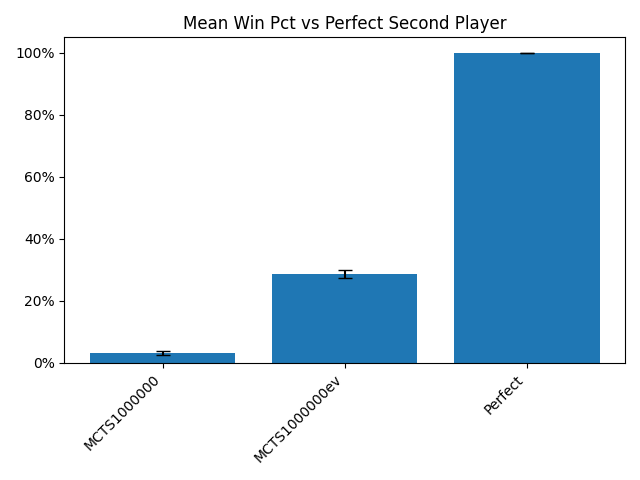

|Player|Games|Mean Wins vs Perfect Second Player|Standard Error|
|---|---|---|---|
|MCTS1000000|1000|3.10|0.55|
|MCTS1000000ev|1000|28.60|1.43|
|Perfect||100.00||

Interestingly, even though the win rate vs a perfect second player was improved, the mean moves to a win by a perfect first player was not:

|Player|Moves|Mean Moves to Perfect First Player Win vs Player|Standard Error|
|---|---|---|---|
|MCTS1000000ev|1000|29.2620|0.0957|
|MCTS1000000|1000|33.6160|0.0581|
|Perfect||41||

Nor was there an increase in overall perfect move percentage:

|Player|Move|Mean Perfect Move Pct|Standard Error|
|---|---|---|---|
|MCTS1000000ev|20000|83.44|0.26|
|MCTS1000000|20000|83.91|0.26|
|Perfect||100||

Breaking the overall perfect move percentage out into the first and second player cases we see an increase as first player and a decrease as second player:

|Player|Move|Mean Perfect Move Pct as First Player|Standard Error|
|---|---|---|---|
|MCTS1000000|17840|83.34|0.28|
|MCTS1000000ev|18438|89.38|0.23|
|Perfect||100||

|Player|Move|Mean Perfect Move Pct as Second Player|Standard Error|
|---|---|---|---|
|MCTS1000000ev|14131|78.08|0.35|
|MCTS1000000|16308|84.19|0.29|
|Perfect||100||

## Blackjack

[Blackjack](https://en.wikipedia.org/wiki/Blackjack) is a casino card game where each player plays individually against the dealer.

The optimal strategy for a single-deck was first calculated (by hand!) in 1956 by Baldwin, Cantey, Maisel, and McDermott[[4]](#references "Roger R. Baldwin, Wilbert E. Cantey, Herbert Maisel, and James P. McDermott. The optimum strategy in blackjack. Journal of the American Statistical Association, 51(275):429–429, 1956.").
E. O. Thorp later checked their calculations on an IBM 704 at MIT[[5]](#references "E. O. Thorp, A favorable Strategy for Twenty-One, Proc. Natl. Acad. Sci., 47(1), 110-112, 1961.") and then extended their work in his book *Beat The Dealer*[[6]](#references "E. O. Thorp, Beat The Dealer").

For more info on this historical Blackjack analysis, see [https://github.com/grwhitehead/blackjack](https://github.com/grwhitehead/blackjack).

Using Thorp's corrected value, we have the following strategies and their expected winnings (single deck, dealer stands on soft 17, no re-splitting):
|Player Strategy|Expected Winnings per Hand|
|---|---|
|No Bust|-0.05 to -0.08|
|Mimic Dealer|-0.057|
|Baldwin Optimum|0.0009|

### JSMCTS Implementation

[See js/blackjack.js for full details]

The JSMCTS implementation pits one player against the dealer with an initial bet of $1, following the rules analyzed by Baldwin (single deck, dealer stands on soft 17, no re-splitting).
The deck is shuffled after each hand.

Heuristic players were implemented for the No Bust, Mimic Dealer, and Baldwin's Optimum strategies.

The game state copy constructor, used by the MCTS player to initialize search trials, shuffles the remaining cards in the deck to prevent the MCTS player from simply learning the order of the cards in the game deck.

Similarly, to keep the MCTS player from deducing the dealer's hole card, it is returned to the bottom of the deck after checking that neither the dealer nor the player have a natural and then restored at the end of the game.

#### Heuristic Player Performance

The simulation was first validated by running the heuristic players and comparing the results to the theoretical values.

The heuristic players performed as expected:

|Player|Hands|Mean Winnings per Hand|Standard Error|Expected|
|---|---|---|---|---|
|NoBust|1000000|-0.0843|0.0010|-0.05 to -0.08|
|MimicDealer|1000000|-0.0575|0.0010|-0.057|
|Baldwin Optimum|100000000|0.0008|0.0001|0.0009|

#### MCTS Player Performance

The MCTS player was then tested to see how it performed relative to the heuristic players.

Since Blackjack is nondeterministic, tests were first run to see whether or not the MCTS player benefited from determinization (running multiple search trials per PRNG seed, where tpsNUM is NUM trials per seed; without determinization a new PRNG seed is generated for every trial):

|Player|Hands|Mean Winnings per Hand|Standard Error|
|---|---|---|---|
|MCTS1000|10000|-0.1514|0.0144|
|MCTS1000tps10|10000|-0.1179|0.0144|
|MCTS1000tps100|10000|-0.1426|0.0132|
| | | | |
|MCTS10000|10000|-0.1140|0.0143|
|MCTS10000tps10|10000|-0.1042|0.0148|
|MCTS10000tps100|10000|-0.0835|0.0127|
|MCTS10000tps250|10000|-0.1065|0.0128|
|MCTS10000tps500|10000|-0.1145|0.0131|
|MCTS10000tps1000|10000|-0.1276|0.0132|
| | | | |
|MCTS100000|10000|-0.0558|0.0138|
|MCTS100000tps10|10000|-0.1130|0.0148|
|MCTS100000tps100|10000|-0.0450|0.0119|
|MCTS100000tps250|10000|-0.0620|0.0117|
|MCTS100000tps500|10000|-0.0726|0.0121|
|MCTS100000tps1000|10000|-0.1119|0.0124|
| | | | |
|MCTS1000000|10000|-0.0715|0.0135|
|MCTS1000000tps10|10000|-0.1124|0.0146|
|MCTS1000000tps100|10000|-0.0574|0.0115|
|MCTS1000000tps250|10000|-0.0532|0.0111|
|MCTS1000000tps500|10000|-0.0695|0.0113|
|MCTS1000000tps1000|10000|-0.0818|0.0116|
| | | | |
|MCTS10000000tps100|10000|-0.0585|0.0115|
|MCTS10000000tps250|10000|-0.0256|0.0108|
|MCTS10000000tps500|10000|-0.0323|0.0110|
|MCTS10000000tps1000|10000|-0.0644|0.0113|

The best results were with determinization.

Tests were then run for trials in powers of 10 up to 10,000,000 (the largest value for which it was practical to collect data, taking about 30 seconds per hand).

The MCTS player outperformed the Mimic Dealer strategy starting at 100,000 trials:

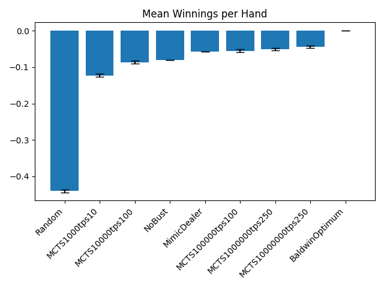

|Player|Hands|Mean Winnings per Hand|Standard Error|
|---|---|---|---|
|Random|100000|-0.4406|0.0042|
|MCTS1000tps10|100000|-0.1224|0.0046|
|MCTS10000tps100|100000|-0.0867|0.0040|
|NoBust||-0.08||
|MimicDealer||-0.057||
|MCTS100000tps100|100000|-0.0550|0.0038|
|MCTS1000000tps250|100000|-0.0506|0.0035|
|MCTS10000000tps250|100000|-0.0434|0.0034|
|BaldwinOptimum||0.0009||

Plotting the distributions of winnings per hand for these games we can see how the MCTS player performance compares to the MimicDealer and BaldwinOptimum players:

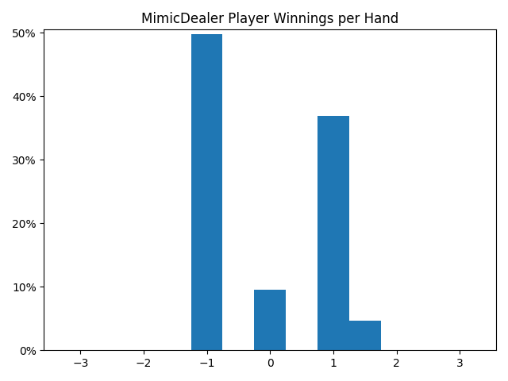

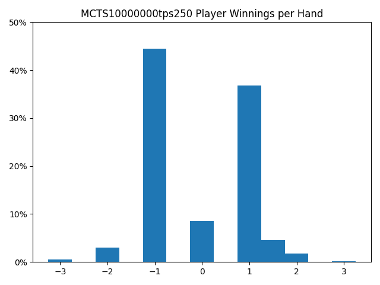

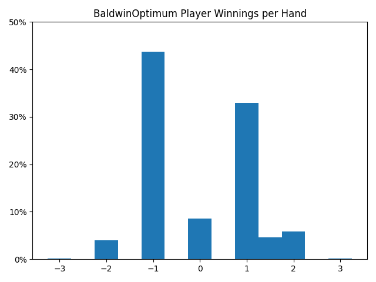

Finally, the actions taken by the players in these games can be compared to the actions that the optimum player would have made, giving a measure of how close they are to optimum play:

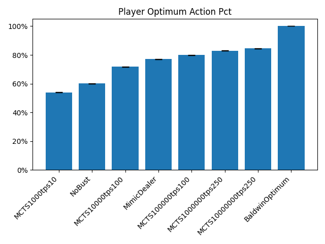

|Player|Actions|Mean Optimum Action Pct|Standard Error|
|---|---|---|---|
|MCTS1000tps10|94905|53.89|0.16|
|NoBust|100000|60.20|0.15|
|MCTS10000tps100|100000|71.73|0.14|
|MimicDealer|100000|77.03|0.13|
|MCTS100000tps100|100000|79.97|0.13|
|MCTS1000000tps250|100000|83.00|0.12|
|MCTS10000000tps250|100000|84.51|0.11|
|BaldwinOptimum||100||

## Pig

[Pig](https://en.wikipedia.org/wiki/Pig_(dice_game)) is a push your luck dice game for two or more players.

Neller and Presser calculated the optimal strategy for pig in 2004, visualizing the roll/hold boundary as a three-dimensional surface[[7]](#references "Neller, T. and Clifton G. M. Presser. “Optimal Play of the Dice Game Pig.” (2004)").
They followed up in 2010 with a simplified human-playable policy, Keep Pace End Race, that is very close to optimal[[8]](#references "Neller, T. and Clifton G. M. Presser. “Practical Play of the Dice Game Pig.” (2010)").

From the 2010 paper, we have the following player strategies and their win percentages against optimal play (two players, one six-sided die, first to 100):
|Player Strategy|Expected Win Pct vs Optimal|
|---|---|---|---|
|Hold At 20|46.00|
|Keep Pace End Race|49.54|
|Optimal|50.00|

Note that the player who goes first has an advantage, so we quote the average of the first and second player win percentages.

### JSMCTS Implementation

[See js/pig.js for full details]

The JSMCTS implementation pits two players against each other, following the rules analyzed by Neller and Presser (one six-sided die, first to 100).

Heuristic players were implemented for the Hold At 20, Keep Pace End Race, and Optimal strategies.
The Optimal player uses a table of probabilities pre-calculated using the value iteration technique described in the 2004 paper.

#### Heuristic Player Performance

The simulation was first validated by running the heuristic players and comparing the results to the theoretical values.

Mean and Standard Error of the Mean were calculated over a number of games, half as first player and half as second player.

The heuristic players performed as expected:

|Player|Games|Mean Win Pct vs Optimal|Standard Error|Expected|
|---|---|---|---|---|
|HoldAt20|100000|46.01|0.16|
|KeepPaceEndRace|100000|49.57|0.16|
|Optimal|100000|50.00|0.16|

#### MCTS Player Performance

The MCTS player was then tested to see how it performed relative to the heuristic players.

Since Pig is nondeterministic, self-play tests were first run to see whether or not the MCTS player benefited from determinization (running multiple search trials per PRNG seed, where tpsNUM is NUM trials per seed; without determinization a new PRNG seed is generated for every trial):

|Player|Games|Mean Win Pct vs MCTS1000|Standard Error|
|---|---|---|---|
|MCTS1000|1000|50.00|1.58|
|MCTS1000tps10|1000|50.10|1.58|
|MCTS1000tps100|1000|49.50|1.58|
| | |**Mean Win Pct vs MCTS10000**| |
|MCTS10000|1000|50.00|1.58|
|MCTS10000tps10|1000|45.30|1.57|
|MCTS10000tps100|1000|38.90|1.54|
|MCTS10000tps1000|1000|37.00|1.53|
| | |**Mean Win Pct vs MCTS100000**| |
|MCTS100000|1000|50.00|1.58|
|MCTS100000tps10|1000|41.90|1.56|
|MCTS100000tps100|1000|36.60|1.52|
|MCTS100000tps1000|1000|24.80|1.37|

The best results were without determinization.

Tests were then run for trials in powers of 10 up to 1,000,000 (the largest value for which it was practical to collect data, taking about 15 seconds per move), with the MCTS player barely outperforming the HoldAt20 player against the Optimal player at 1,000,000 trials:

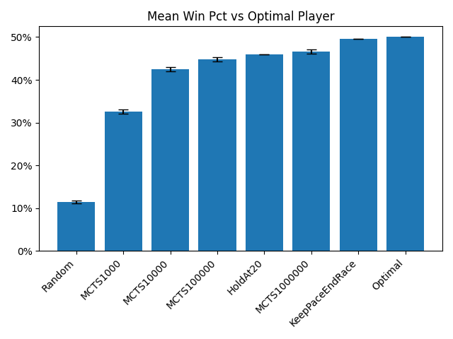

|Player|Games|Mean Win Pct vs Optimal|Standard Error|
|---|---|---|---|
|Random|10000|11.53|0.32|
|MCTS1000|10000|32.61|0.47|
|MCTS10000|10000|42.41|0.49|
|MCTS100000|10000|44.83|0.50|
|HoldAt20||46.00||
|MCTS1000000|10000|46.60|0.50|
|KeepPaceEndRace||49.54||
|Optimal||50.00||

Plotting the hold totals from these games we can see how the MCTS player's decisions compare to the HoldAt20 and Optimal players
(see Neller and Presser's visualization of the roll/hold boundary, fig 3 in their 2004 paper[[7]](#references "Neller, T. and Clifton G. M. Presser. “Optimal Play of the Dice Game Pig.” (2004)")).

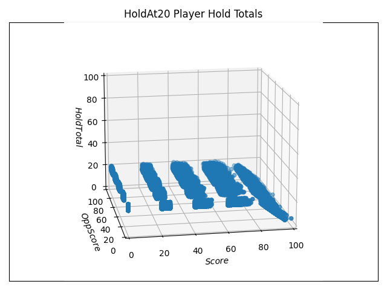

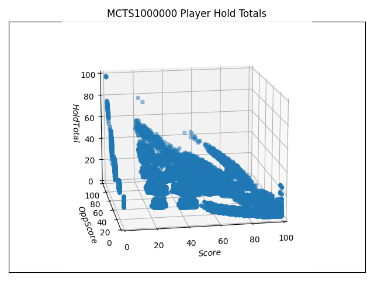

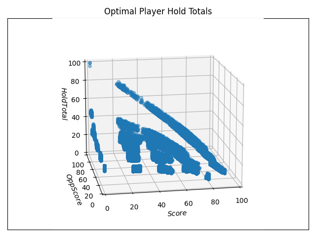

Finally, the actions taken by the players in these games can be compared to the actions that an optimal player would have taken, giving a measure of how close they are to optimal play:

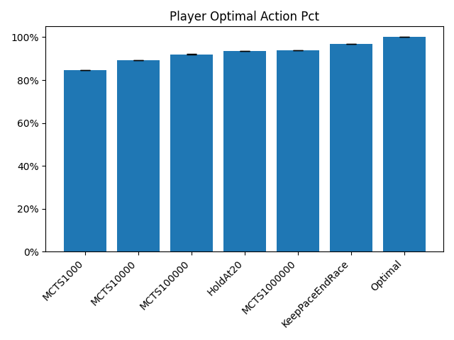

|Player|Actions|Mean Optimal Action Pct|Standard Error|
|---|---|---|---|
|MCTS1000|400000|84.57|0.06|
|MCTS10000|400000|89.27|0.05|
|MCTS100000|400000|92.05|0.04|
|HoldAt20|400000|93.49|0.04|
|MCTS1000000|400000|93.89|0.04|
|KeepPaceEndRace|400000|96.97|0.03|
|Optimal||100||

Interestingly, the MCTS player has a greater advantage over the HoldAt20 player in head-to-head play, beating it at just 10,000 trials:

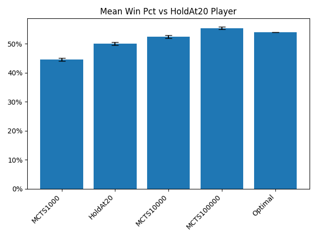

|Player|Samples|Mean Win Pct vs HoldAt20|Standard Error|
|---|---|---|---|
|MCTS1000|10000|44.53|0.50|
|HoldAt20|10000|50.00|0.50|
|MCTS10000|10000|52.45|0.50|
|MCTS100000|10000|55.42|0.50|
|Optimal||54.00||

## Notes

Tests were run on a 2019 MacBook Pro with a 2.3 GHz 8 Core Intel Core i9 and 16GB RAM, and on a server with a 3.55 GHz 32 Core AMD Zen 5 and 64GB RAM.

## References

[1] Crowley, K. and Siegler, R.S., Flexible Strategy Use in Young Children's Tic-Tac-Toe. Cognitive Science, 17: 531-561, 1993.

[2] Allen, J.D.: The Complete Book of Connect 4: History, Strategy, Puzzles. Puzzle Wright Press (2010)

[3] Allis, L.V.: A knowledge-based approach of connect-four. J. Int. Comput. Games Assoc. 11(4), 165 (1988)

[4] Roger R. Baldwin, Wilbert E. Cantey, Herbert Maisel, and James P. McDermott. The optimum strategy in blackjack. Journal of the American Statistical Association, 51(275):429–429, 1956.

[5] E. O. Thorp, A favorable Strategy for Twenty-One, Proc. Natl. Acad. Sci., 47(1), 110-112, 1961.

[6] E. O. Thorp, Beat The Dealer

[7] Neller, T. and Clifton G. M. Presser. “Optimal Play of the Dice Game Pig.” (2004)

[8] Neller, T. and Clifton G. M. Presser. “Practical Play of the Dice Game Pig.” (2010)

Copyright (c) 2023-2026 Greg Whitehead

MIT License

